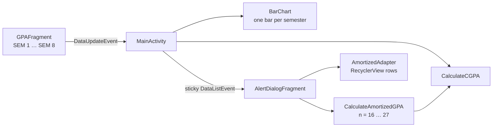

<p align="center"></p>

<p align="center">
  <a href="LICENSE"></a>
  
  
  
  <a href="https://github.com/abhinav-adtechs/CGPAAmortizedAnalysis/stargazers"></a>
  <a href="CONTRIBUTING.md"></a>
</p>

<p align="center"><b>Enter your semester GPAs and credits. The app tells you the lowest GPA you can score next semester and still finish at a 9.0 CGPA, for every credit load from 16 to 27.</b></p>

<p align="center">
  <a href="#features">Features</a> ·
  <a href="#quick-start">Quick start</a> ·
  <a href="#architecture">Architecture</a> ·
  <a href="#docs">Docs</a> ·
  <a href="#roadmap">Roadmap</a> ·
  <a href="#contributing">Contributing</a>
</p>

> [!NOTE]
> **Status: classic project.** Built in May 2016 as a student project and restructured into MVC packages in June 2016. It is not actively maintained. The code targets Android SDK 23 and the 2016 support libraries. See [Quick start](#quick-start) for how to open it today.

## Why CGPAAmortizedAnalysis?

On a 10-point, credit-weighted scale, the question every student eventually asks is _"what do I need next semester to stay above 9?"_ The honest answer depends on how many credits you've already banked and how heavy the next semester is.

This app answers it for every credit load at once. It treats your grade-point surplus (or deficit) as something to **amortize** over the next semester's credits, the same bookkeeping as amortized analysis in algorithms. The full derivation is in [`docs/ALGORITHM.md`](docs/ALGORITHM.md).

## Features

<table>
  <tr>
    <td width="50%" valign="top">
      <h3>📝 Semester-by-semester entry</h3>
      A swipeable eight-page pager, one card per semester, with GPA and credit fields. Input is checked for blanks and a 0–10 GPA range before it counts.
    </td>
    <td width="50%" valign="top">
      <h3>📊 Live GPA bar chart</h3>
      Every submitted semester adds an animated bar to an MPAndroidChart <code>BarChart</code> labelled <code>SEM 1</code>…<code>SEM 8</code>.
    </td>
  </tr>
  <tr>
    <td valign="top">
      <h3>🧮 Credit-weighted CGPA</h3>
      Recomputed after every entry as Σ(GPA × credits) / Σ credits, with a verdict line: <i>"Go and Explore the world!"</i> above 9, <i>"Start Studying!"</i> otherwise.
    </td>
    <td valign="top">
      <h3>🎯 Minimum-GPA table</h3>
      For next-semester loads of 16–27 credits, the lowest GPA that keeps your CGPA at 9.0. It reads <b>"Above 10"</b> when that load can't get you there.
    </td>
  </tr>
  <tr>
    <td valign="top">
      <h3>📈 Amortized-analysis maths</h3>
      <code>g* = 9 + C·(9 − CGPA) / n</code>: your banked surplus or debt, spread over the next <i>n</i> credits. The derivation and examples are in <a href="docs/ALGORITHM.md">ALGORITHM.md</a>.
    </td>
    <td valign="top">
      <h3>🔁 Event-driven MVC</h3>
      <code>Model</code> / <code>View</code> / <code>Controller</code> packages wired with greenrobot EventBus. A sticky event hands the semester list to the estimate dialog.
    </td>
  </tr>
</table>

## Tech stack

**Language & platform**
<br>


**Libraries**
<br>


## Architecture



You enter a semester on a `GPAFragment` page, which posts a `DataUpdateEvent` through EventBus. `MainActivity` stores it, recomputes the CGPA, adds a bar, advances the pager, and opens `AlertDialogFragment` with the full list as a sticky event. The dialog builds the 16–27-credit table. Package map, sequence diagram and lifecycle notes are in [`docs/ARCHITECTURE.md`](docs/ARCHITECTURE.md).

## Quick start

> [!IMPORTANT]
> The repository contains **only the `app/` module**. There is no root `settings.gradle`, `build.gradle` or Gradle wrapper, so you need to add them before Android Studio will open the project.

**Era-faithful setup (2016 toolchain):** Android Studio 2.x, JDK 8, SDK Platform 23, Build Tools 23.0.3 and the Android Support Repository. Use a device or emulator on API 22+.

1. **Clone**

   ```bash
   git clone https://github.com/abhinav-adtechs/CGPAAmortizedAnalysis.git
   cd CGPAAmortizedAnalysis
   ```

2. **Add the two missing root files.** These are period-appropriate versions; AGP 2.1.x was current in May 2016:

   `settings.gradle`

   ```groovy
   include ':app'
   ```

   `build.gradle`

   ```groovy
   buildscript {
       repositories { jcenter() }
       dependencies { classpath 'com.android.tools.build:gradle:2.1.0' }
   }
   allprojects {
       repositories { jcenter() }
   }
   ```

3. **Open the folder in Android Studio** and accept its offer to set up the Gradle wrapper. Then run the `app` configuration.

4. **Try the built-in sample.** Enter the four semesters that `AlertFragment` hard-codes, one per page, tapping **Add GPA** each time:

   | Page       | GPA | Credits |
   | ---------- | --- | ------- |
   | SEMESTER 1 | 9.4 | 24      |
   | SEMESTER 2 | 9.3 | 26      |
   | SEMESTER 3 | 9.2 | 24      |
   | SEMESTER 4 | 9.0 | 24      |

   The last dialog should list a minimum GPA of about **7.61** for 16 credits, rising to about **8.18** for 27. The verdict line should show a CGPA of about 9.23. [ALGORITHM.md §6](docs/ALGORITHM.md#6-worked-examples) works through the numbers.

> [!TIP]
> **Using a current Android Studio?** jcenter has been retired and the 2016 Gradle plugin won't run on modern JDKs. The least painful route is a fresh _Empty Views Activity_ project (Java, package `abhinav.hackdev.co.amortizedanalysis`, min SDK 22). Copy `app/src/main/java` and `app/src/main/res` into it and add the dependencies with modern coordinates:
>
> - `implementation` instead of `compile`
> - AndroidX (`androidx.appcompat:appcompat`, `androidx.recyclerview:recyclerview`, and `androidx.legacy:legacy-support-v13` for the framework-fragment `FragmentPagerAdapter`), then update the `android.support.*` imports to their `androidx.*` equivalents
> - `org.greenrobot:eventbus` from Maven Central
> - MPAndroidChart `v2.2.4` from JitPack (the v3 API differs)
>
> If `ink-page-indicator:1.1.1` no longer resolves, remove the indicator from `activity_main.xml` and `MainActivity`. It is cosmetic.

## Configuration

No environment variables or settings screen. The behaviour is fixed by these constants:

| What                       | Value    | Where                                                                                                      |
| -------------------------- | -------- | ---------------------------------------------------------------------------------------------------------- |
| Target CGPA                | `9`      | `Model/Entities/CalculateAmortizedGPA.java` L30, dialog title in `res/layout/fragment_alert_amortized.xml` |
| Next-semester credit loads | 16–27    | `View/Fragments/AlertDialogFragment.java` L80                                                              |
| Number of semesters        | 8        | `Controller/CustomAdapter.java` L28, chart labels in `MainActivity.java` L94–96                            |
| Valid GPA range            | 0–10     | `View/Fragments/GPAFragment.java` L68                                                                      |
| Verdict threshold          | CGPA > 9 | `View/Activities/MainActivity.java` L158                                                                   |

_(Paths relative to `app/src/main/java/abhinav/hackdev/co/amortizedanalysis/` unless they start with `res/`.)_

## Project structure

```text
CGPAAmortizedAnalysis/
├── app/
│   ├── build.gradle                         # SDK 23, minSdk 22, dependencies
│   └── src/main/
│       ├── AndroidManifest.xml
│       ├── java/abhinav/hackdev/co/amortizedanalysis/
│       │   ├── Controller/
│       │   │   ├── CustomAdapter.java       # 8-page semester pager adapter
│       │   │   └── AmortizedAdapter.java    # minimum-GPA table rows ("Above 10" clamp)
│       │   ├── Model/
│       │   │   ├── Entities/
│       │   │   │   ├── CalculateCGPA.java          # ★ credit-weighted CGPA
│       │   │   │   ├── CalculateAmortizedGPA.java  # ★ minimum GPA for next semester
│       │   │   │   ├── GPAData.java · EstimatedList.java · GPAList.java
│       │   │   └── EventBusEvents/
│       │   │       └── DataUpdateEvent.java · DataListEvent.java
│       │   └── View/
│       │       ├── Activities/MainActivity.java     # pager, bar chart, verdict
│       │       ├── Fragments/GPAFragment.java       # one semester's input card
│       │       ├── Fragments/AlertDialogFragment.java  # estimate dialog
│       │       ├── Fragments/AlertFragment.java     # demo activity with sample data
│       │       └── CustomViews/CustomViewPager.java
│       └── res/layout/                      # activity_main, fragment_gpa, fragment_alert_amortized, list_item
└── docs/
    ├── ALGORITHM.md                         # derivation, amortized view, worked examples
    └── ARCHITECTURE.md                      # packages, event flow, build config
```

## Docs

| Document                                       | What's inside                                                                                                                                           |
| ---------------------------------------------- | ------------------------------------------------------------------------------------------------------------------------------------------------------- |
| [`docs/ALGORITHM.md`](docs/ALGORITHM.md)       | CGPA and minimum-GPA formulas with line references, the aggregate/potential-method view of "amortized", reachability bound, worked examples, edge cases |
| [`docs/ARCHITECTURE.md`](docs/ARCHITECTURE.md) | MVC package map, EventBus sequence diagram, lifecycle notes, build configuration                                                                        |
| [`CHANGELOG.md`](CHANGELOG.md)                 | Release history derived from the commit log                                                                                                             |

## Roadmap

- [ ] Fix double counting when a semester is submitted twice
- [ ] Fix the crash when a later semester is entered before earlier ones
- [ ] Validate credits (> 0) so the CGPA can't become `NaN`
- [ ] Make the target CGPA configurable instead of a hard-coded 9
- [ ] Spread the deficit over several remaining semesters when one isn't enough ("Above 10")
- [ ] Unit tests for `CalculateCGPA` and `CalculateAmortizedGPA`
- [ ] Add root Gradle files and migrate the build to current AGP/AndroidX
- [ ] Persist entered semesters across rotation and restarts

## Contributing

Issues and PRs are welcome, especially anything on the roadmap. See [CONTRIBUTING.md](CONTRIBUTING.md) for setup, commit conventions and the PR checklist.

## License

MIT © 2016–2026 Abhinav Das. See [LICENSE](LICENSE).

## Star history

<a href="https://star-history.com/#abhinav-adtechs/CGPAAmortizedAnalysis&Date"></a>

---

<p align="center">Built by <a href="https://github.com/abhinav-adtechs">Abhinav Das</a><br>If this project helped you, consider giving it a ⭐</p>
