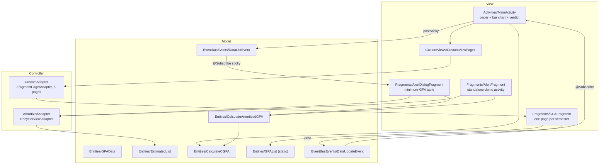
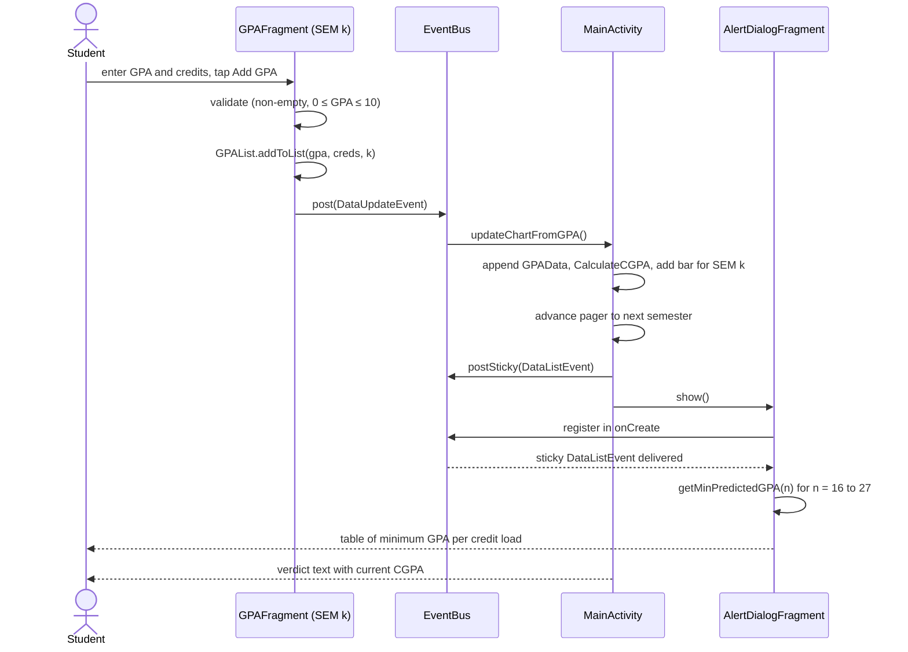

# Architecture

CGPAAmortizedAnalysis is a single-activity Android app written in May 2016. In June 2016 it was reorganized into **Model / View / Controller** packages. Components talk to each other through [greenrobot EventBus](https://github.com/greenrobot/EventBus) rather than direct references. Nothing is persisted, and there is no network access.

For the formulas, see [`ALGORITHM.md`](ALGORITHM.md).

## Package map

All paths are relative to `app/src/main/java/abhinav/hackdev/co/amortizedanalysis/`.

| File                                        | Role                                                                                                                                                                                                            |
| ------------------------------------------- | --------------------------------------------------------------------------------------------------------------------------------------------------------------------------------------------------------------- |
| `View/Activities/MainActivity.java`         | Launcher activity. Hosts the semester pager, an `InkPageIndicator`, an MPAndroidChart `BarChart` (one bar per semester, x-labels `SEM 1`…`SEM 8`), and the verdict `TextView`. Subscribes to `DataUpdateEvent`. |
| `View/Fragments/GPAFragment.java`           | One pager page per semester: GPA and credits inputs plus an **Add GPA** button. Validates the input and posts a `DataUpdateEvent`.                                                                              |
| `View/Fragments/AlertDialogFragment.java`   | Dialog shown after each submission. Receives the sticky `DataListEvent` and lists the minimum next-semester GPA for 16–27 credits.                                                                              |
| `View/Fragments/AlertFragment.java`         | An `AppCompatActivity` (despite the name) that renders the same table from hard-coded sample data. It is declared in the manifest but not launched by the app.                                                  |
| `View/CustomViews/CustomViewPager.java`     | Plain `ViewPager` subclass with no overrides, so swiping between pages is allowed.                                                                                                                              |
| `Controller/CustomAdapter.java`             | `FragmentPagerAdapter` (support-v13) that returns `GPAFragment.newInstance(position + 1)` for 8 pages.                                                                                                          |
| `Controller/AmortizedAdapter.java`          | `RecyclerView` adapter for `EstimatedList` rows. Shows "Above 10" when the estimate exceeds 10.                                                                                                                 |
| `Model/Entities/GPAData.java`               | `(semGPA: float, semCreds: int, semVal: int)`, one entered semester.                                                                                                                                            |
| `Model/Entities/EstimatedList.java`         | `(estCreds: int, estGPA: float)`, one row of the minimum-GPA table.                                                                                                                                             |
| `Model/Entities/CalculateCGPA.java`         | Credit-weighted CGPA over a `List<GPAData>`.                                                                                                                                                                    |
| `Model/Entities/CalculateAmortizedGPA.java` | `getMinPredictedGPA(n)`: the minimum GPA next semester to reach CGPA 9 with `n` credits.                                                                                                                        |
| `Model/Entities/GPAList.java`               | A static `List<Float>` that `GPAFragment` writes into. Nothing reads it.                                                                                                                                        |
| `Model/EventBusEvents/DataUpdateEvent.java` | `(dataValue, dataCredits, dataIndex)`, posted by `GPAFragment`.                                                                                                                                                 |
| `Model/EventBusEvents/DataListEvent.java`   | Wraps the full `ArrayList<GPAData>`. Posted sticky by `MainActivity`.                                                                                                                                           |

## What happens when you tap "Add GPA"

Notes:

- **Event delivery.** `updateChartFromGPA` uses the default `@Subscribe`, so it runs on the posting thread, which is the UI thread (a click handler). `AlertDialogFragment.setListItem` is `sticky = true, threadMode = MAIN`. It registers in `onCreate`, so the sticky event arrives before `onViewCreated` builds the table.
- **Lifecycle asymmetry.** `MainActivity` registers with EventBus in `onStart` but unregisters in `onPause`. After a pause/resume that doesn't pass through `onStop`/`onStart`, the activity stays unregistered and submissions are ignored.
- **State.** `gpaDataArrayList` is an in-memory field of `MainActivity`. It isn't saved across configuration changes or process death.

## Build configuration

The repository contains **only the `app/` module**. There is no root `settings.gradle`, top-level `build.gradle` or Gradle wrapper, and there never was (the initial commit `a955fdd` already had just `app/`).

| Setting                                   | Value (`app/build.gradle`)                                                                                                                                               |
| ----------------------------------------- | ------------------------------------------------------------------------------------------------------------------------------------------------------------------------ |
| `compileSdkVersion` / `buildToolsVersion` | 23 / 23.0.3                                                                                                                                                              |
| `minSdkVersion` / `targetSdkVersion`      | 22 / 23                                                                                                                                                                  |
| `applicationId`                           | `abhinav.hackdev.co.amortizedanalysis`                                                                                                                                   |
| Repositories                              | Only JitPack is declared, in `app/build.gradle`. Any others would have been in the absent root `build.gradle`.                                                          |
| Dependencies                              | `appcompat-v7`, `support-v13`, `recyclerview-v7`, `cardview-v7` (all 23.3.0; `cardview-v7` is declared but unused); `MPAndroidChart:v2.2.4`; `ink-page-indicator:1.1.1`; `eventbus:3.0.0`; `junit:4.12` (test) |

The README's Quick start explains how to add the missing root files. Tests at `HEAD` are the Android Studio templates (`ExampleUnitTest`, `ApplicationTest`).

## History in one paragraph

The app was written between 5 and 10 May 2016:

1. Pager scaffolding.
2. The bar chart ("Charts done.").
3. The CGPA calculation and the amortized estimate.
4. The dialog wiring ("DONE.", 10 May).

A 15 May tweak added the "Above 10" label. On 21 June 2016 the flat package was reorganized into `Model`/`View`/`Controller`. See [`CHANGELOG.md`](../CHANGELOG.md).
